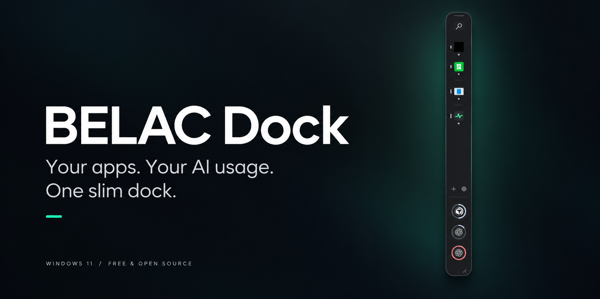
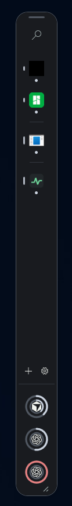
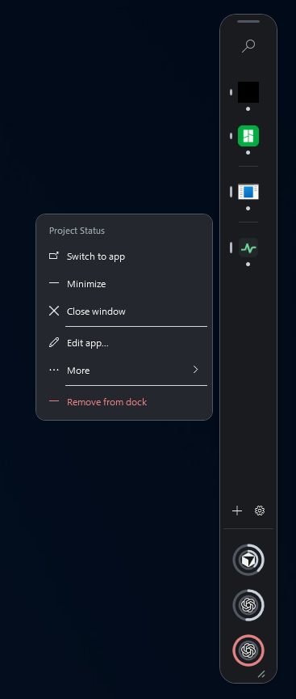
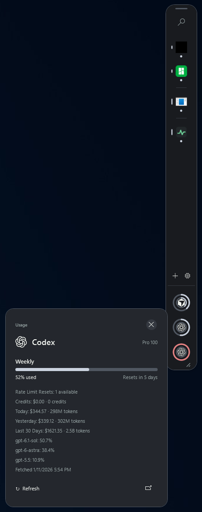
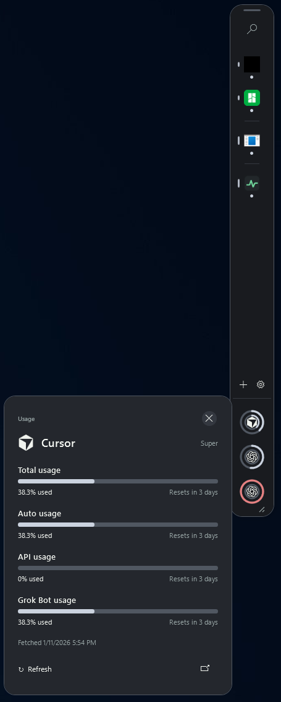

<p align="center">
  
</p>

<p align="center">
  <a href="https://github.com/Belacosaur/BELAC-Dock/releases/latest"></a>
  <a href="https://github.com/Belacosaur/BELAC-Dock/actions/workflows/ci.yml"></a>
  <a href="LICENSE"></a>
</p>

<p align="center">
  <strong><a href="https://github.com/Belacosaur/BELAC-Dock/releases/download/v1.0.0/BELAC.Dock-v1.0.0-win-x64.zip">Download for Windows 11 x64</a></strong>
  · <a href="#quick-start">Quick start</a>
  · <a href="#screenshots">Screenshots</a>
  · <a href="https://github.com/Belacosaur/BELAC-Dock/releases/latest">Release notes</a>
  · <a href="https://github.com/Belacosaur/BELAC-Dock/issues">Report a bug</a>
</p>

<p align="center">A slim, floating taskbar that keeps your Windows apps and AI usage within reach.</p>

## Quick start

1. **[Download the Windows ZIP](https://github.com/Belacosaur/BELAC-Dock/releases/download/v1.0.0/BELAC.Dock-v1.0.0-win-x64.zip)** and extract the entire folder.
2. Run **BELAC.Dock.exe** and choose your apps.
3. Drag the top handle to position your dock. Pick a colour in **Settings → Appearance**.

**Windows 11 · x64 · Portable · .NET runtime included**  
No installer or separate runtime is needed. The build is unsigned. Checksums are available on the [release page](https://github.com/Belacosaur/BELAC-Dock/releases/latest).

## Made for your desktop

| | |
| :--- | :--- |
| **A small footprint** | A thin floating bar with drag-to-move, resizing and remembered geometry. |
| **Your apps, one click away** | Launch, focus and minimize apps, or choose between their open windows. Add executables and shortcuts by dragging them onto the dock. |
| **Your colours** | Mint, Ocean, Violet, Rose, Amber and Slate, applied live across the dock, menus and popouts. |
| **AI usage at a glance** | Provider logos, usage rings and compact details from your local OpenTokenUsage service. |
| **Optional taskbar control** | Choose Mirror or Dock-only per app, with saved preferences and recovery across restarts. |
| **Windows preferences respected** | High contrast and reduced motion are honoured automatically. |

## Screenshots

<table>
  <tr><th>Floating taskbar</th><th>App actions</th></tr>
  <tr>
    <td align="center"></td>
    <td align="center"></td>
  </tr>
  <tr><th>Codex usage</th><th>Cursor usage</th></tr>
  <tr>
    <td align="center"></td>
    <td align="center"></td>
  </tr>
</table>

<sub>These are actual app screenshots. The header is an AI-generated promotional illustration based on the dock.</sub>

## Everyday controls

| Action | How |
| :--- | :--- |
| Add an app | Drop an `.exe` or `.lnk` onto the dock, or use **+**. |
| Move or resize | Drag the top handle or the lower corner. |
| Open app actions | Right-click an app; advanced options are under **More**. |
| Change colours | **Settings → Appearance → Colour theme**. |
| Bring the dock back | Use the tray icon or **Ctrl+Alt+Shift+D**. |
| Start at sign-in | Enable it in Settings; it is off by default. |

## LLM usage

Usage rings read from a separate **OpenTokenUsage** service running on `http://127.0.0.1:6736`. The dock does not need provider API keys. If that service is unavailable, the dock still works as an app launcher.

See the [usage integration guide](USAGE_INTEGRATION.md) for the local API contract.

## Taskbar modes

**Mirror** is the default: apps remain in the Windows taskbar. **Dock-only** attempts to hide their running taskbar buttons and reapplies that preference after app or dock restarts.

- Pinned shortcuts stay pinned. The dock never unpins them.
- The optional **Style compatibility** fallback can also remove an app from Alt+Tab.
- Choose Mirror, pause separation or exit through the tray to restore managed windows.
- Elevated/protected apps and some taskbar implementations may remain unsupported. Failed verification is reported rather than treated as success.

Read the [compatibility notes](docs/COMPATIBILITY.md) for limitations and the [troubleshooting guide](docs/TROUBLESHOOTING.md) for recovery steps.

## Build and contribute

Use Windows and the [.NET 10 SDK](https://dotnet.microsoft.com/download/dotnet/10.0):

```powershell
git clone https://github.com/Belacosaur/BELAC-Dock.git
cd BELAC-Dock
.\scripts\build.ps1
.\scripts\test.ps1
```

Interactive checks: `scripts/test-ui.ps1`. Create portable and source packages with `scripts/publish.ps1` and `scripts/source-release.ps1`; outputs go to `dist` and are not uploaded automatically.

[Contributing](CONTRIBUTING.md) · [Architecture](ARCHITECTURE.md) · [Testing](docs/TESTING.md) · [Report a bug](https://github.com/Belacosaur/BELAC-Dock/issues)

## Privacy and license

Settings, logs and recovery data stay in `%LOCALAPPDATA%\BELAC\Dock`. For isolated development, set `BELAC_DOCK_HOME` to a separate directory. Review diagnostic exports before sharing; they can contain local paths and window information. See [Security](SECURITY.md).

Released under the [MIT license](LICENSE). Provider marks belong to their respective owners and do not imply endorsement. See [third-party notices](THIRD_PARTY_NOTICES.md).
